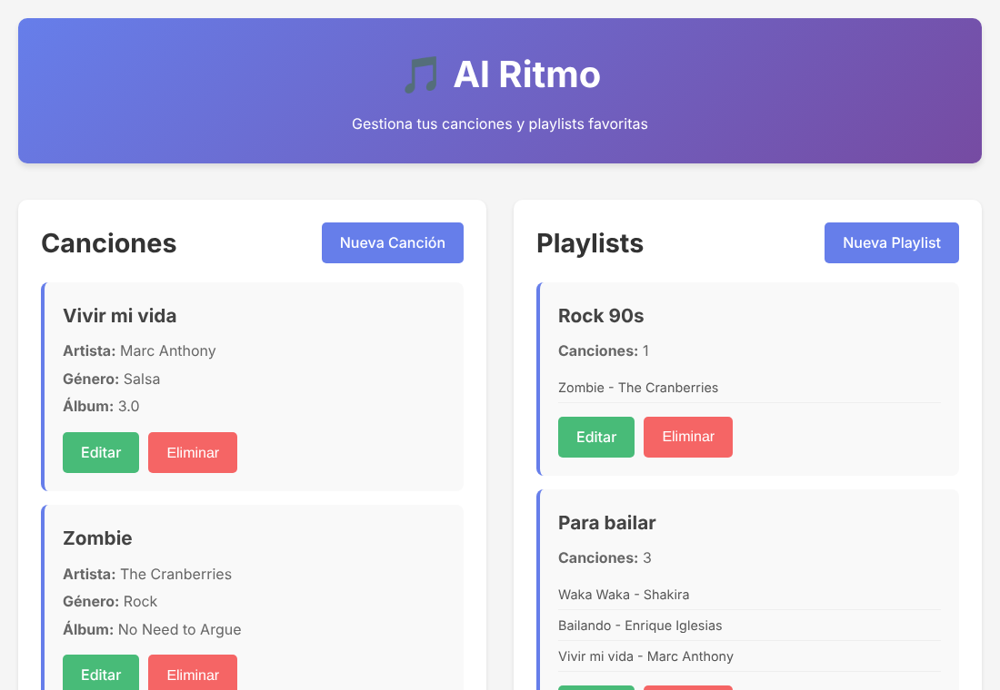
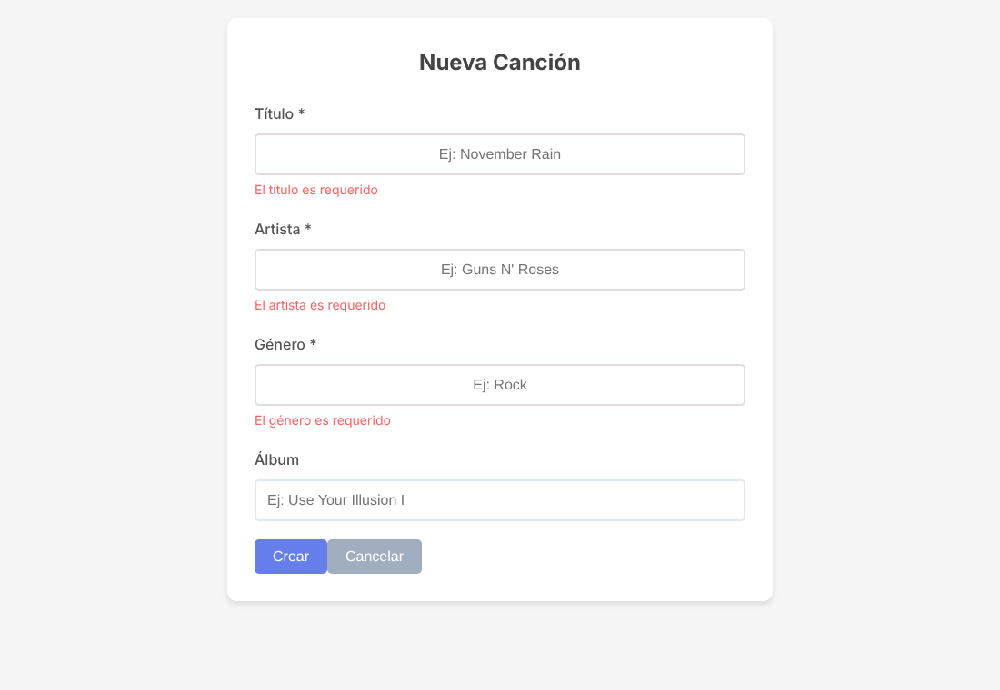
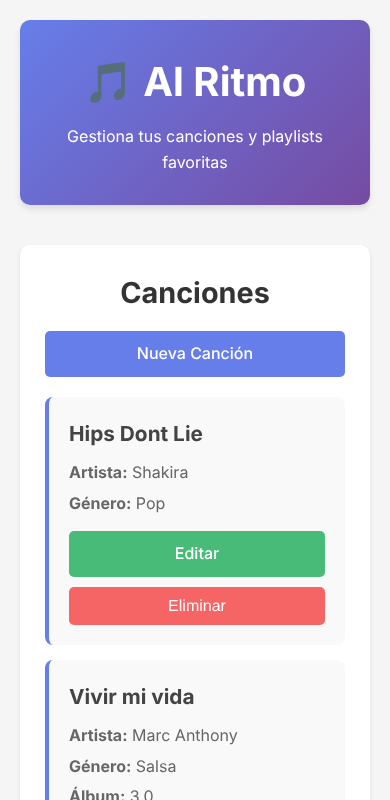
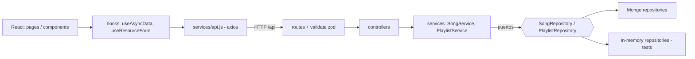

# 🎵 Al Ritmo MERN

Aplicación full stack para gestionar canciones y playlists: API REST en capas con Express 5 + MongoDB y cliente React + Vite, ambos con pruebas automatizadas.

[](https://github.com/zulnidi/al_ritmo_mern/actions/workflows/ci.yml)

**English summary:** Full-stack MERN app for songs and playlists. The Express 5 API is layered (routes → controllers → services → repositories) with dependency injection from a single composition root, Zod validation and centralized error handling. The React 19 + Vite client reuses a generic list section, a form hook and accessible form fields. 31 server tests (Jest + Supertest, in-memory repositories) and 22 client tests (Vitest + Testing Library). The Mongoose repositories are not covered by automated tests (no MongoDB in the dev environment).

## Qué hace

- CRUD de **canciones** (título, artista, género, álbum) con búsqueda, filtro por género y paginación.
- CRUD de **playlists** con canciones asociadas (sin duplicados); al borrar una canción se quita de las playlists.
- Validación en cliente y servidor con mensajes por campo; estados de carga, vacío y error con reintento.

## Capturas

| Inicio | Validación | Móvil |
|---|---|---|
|  |  |  |

_Capturas tomadas con el servidor corriendo sobre repositorios en memoria (datos de demostración)._

## Arquitectura



`server/src/server.js` es el único *composition root*: crea los repositorios Mongo y los inyecta en `createApp` ([`app.js`](server/src/app.js)). Las pruebas inyectan los repositorios en memoria.

## Decisiones de diseño

- **Inversión de dependencias:** [`SongService`](server/src/services/SongService.js) y [`PlaylistService`](server/src/services/PlaylistService.js) dependen de los contratos [`SongRepository`](server/src/repositories/SongRepository.js) y [`PlaylistRepository`](server/src/repositories/PlaylistRepository.js), no de Mongoose.
- **Responsabilidad única:** validadores Zod, controladores HTTP, servicios con reglas de negocio y repositorios de persistencia están separados.
- **DRY en servidor:** [`createCrudController`](server/src/controllers/resourceController.js) sirve a canciones y playlists.
- **DRY en cliente:** [`ResourceSection`](client/src/components/ResourceSection.jsx) (listados), [`useResourceForm`](client/src/hooks/useResourceForm.js), [`useAsyncData`](client/src/hooks/useAsyncData.js) y [`FormField`](client/src/components/ui/FormField.jsx) se reutilizan en ambas pantallas.
- **Errores:** `AppError` + [`errorHandler`](server/src/middleware/errorHandler.js) mapean a 400/404/409/413; los 500 no filtran detalles en producción.
- **Seguridad:** helmet, CORS por entorno, rate limit, JSON ≤ 100 kb, regex escapadas en búsquedas.
- **Accesibilidad:** etiquetas enlazadas, `aria-invalid`, `role="alert"`, nombres accesibles en botones, foco visible.

## Cambios respecto a la versión original

- El servidor ahora vive en `server/src` y se arranca con `src/server.js`.
- Cliente migrado de Create React App a Vite; la URL de la API se configura con `VITE_API_URL`.
- Las listas siguen devolviendo un arreglo; la paginación va en las cabeceras `X-Total-Count`, `X-Page`, `X-Total-Pages`.
- Los errores de validación ahora incluyen `fields` (mensaje por campo) además de `errors`.

## Cómo ejecutarlo

Necesitas Node 22 y una base MongoDB (local o Atlas).

```bash
# Servidor
cd server && cp .env.example .env     # define MONGODB_URI
npm install && npm run dev            # http://localhost:5000

# Cliente (otra terminal)
cd client && cp .env.example .env
npm install && npm run dev            # http://localhost:5173
```

### Variables de entorno (servidor)

| Variable | Descripción |
|---|---|
| `MONGODB_URI` | Cadena de conexión (obligatoria) |
| `PORT` | Puerto (5000 por defecto) |
| `CORS_ORIGIN` | Orígenes permitidos separados por coma |
| `RATE_LIMIT_MAX` | Peticiones por IP cada 15 min |

## API

| Método | Ruta | Descripción |
|---|---|---|
| GET | `/api/health` | Estado |
| GET, POST | `/api/songs` | Listar (`page`, `limit`, `search`, `genre`) / crear |
| GET, PUT, DELETE | `/api/songs/:id` | Ver / editar (parcial) / eliminar |
| GET, POST | `/api/playlists` | Listar (`page`, `limit`, `search`) / crear |
| GET, PUT, DELETE | `/api/playlists/:id` | Ver / editar / eliminar |
| POST | `/api/playlists/:id/songs` | Agregar canción (`{ songId }`) |
| DELETE | `/api/playlists/:id/songs/:songId` | Quitar canción |

## Pruebas

```bash
cd server && npm test && npm run coverage   # 31 pruebas
cd client && npm test && npm run coverage   # 22 pruebas
```

- **Servidor:** servicios con repositorios en memoria y API completa con Supertest (validación, paginación, 404/409, rate limit, 500).
- **Cliente:** listados, formularios, validación local y del servidor, rutas.
- **Límite:** los repositorios Mongoose (`Mongo*Repository.js`) y `server.js` están excluidos de la cobertura porque no se probaron contra un MongoDB real. La integración completa cliente ↔ servidor se verificó manualmente con repositorios en memoria.

## Estructura

```
server/src/  app.js · server.js · config · controllers · routes · services
             repositories (contratos, mongo, memory) · validators · middleware · errors
client/src/  components (ui, listados, formularios) · hooks · lib · pages · services
```

## Próximos pasos

- Pruebas de integración de los repositorios Mongo (p. ej. `mongodb-memory-server`).
- Autenticación y playlists por usuario; despliegue.

## Autora

**Zullie Nicole Díaz López** · [GitHub](https://github.com/zulnidi)
